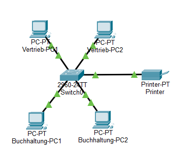
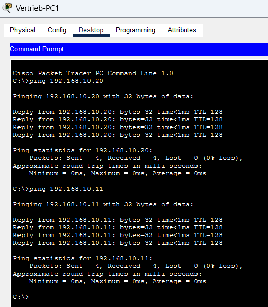

# Projekt 01 – Kleines Büronetzwerk

## 1. Projektübersicht

In diesem Projekt habe ich ein kleines Büronetzwerk mit Cisco Packet Tracer erstellt.

Das Netzwerk besteht aus zwei Abteilungen: Buchhaltung und Vertrieb.

**Verwendete Geräte:**
- 1 Cisco Switch (2960)
- 4 Computer
- 1 Netzwerkdrucker

## 2. Projektziel

Alle Computer sollen miteinander kommunizieren können. Außerdem soll der Netzwerkdrucker von allen Computern erreichbar sein.

## 3. IP-Adressierung

| Gerät | IP-Adresse |
|---|---|
| Buchhaltung-PC1 | 192.168.10.10 |
| Buchhaltung-PC2 | 192.168.10.11 |
| Vertrieb-PC1 | 192.168.10.12 |
| Vertrieb-PC2 | 192.168.10.13 |
| Drucker | 192.168.10.20 |

**Subnetzmaske:** 255.255.255.0

Alle Geräte haben statische IP-Adressen und befinden sich im selben lokalen Netzwerk.

## 4. Netzwerktopologie

## 5. Funktionstests

Ich habe die Netzwerkverbindungen mit dem Ping-Befehl überprüft.

Die getesteten Verbindungen waren erfolgreich. Bei diesen Tests gab es keinen Paketverlust (0 %).

## 6. Fazit

In diesem Projekt habe ich ein kleines LAN geplant und aufgebaut.

Ich habe statische IP-Adressen konfiguriert und die Netzwerkverbindungen überprüft.

Dabei konnte ich meine Kenntnisse in der Netzwerktechnik praktisch anwenden.
